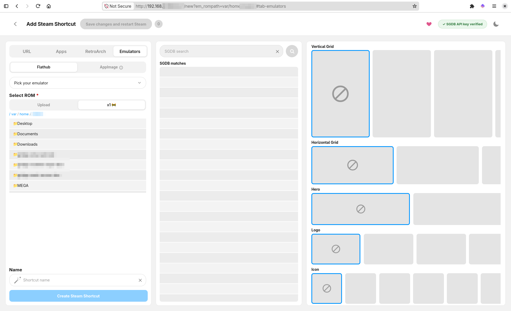

<p align="center">
  <picture>
    <source media="(prefers-color-scheme: dark)" srcset="screenshots/selfsteam-logo-light-text.svg">
    
  </picture>
</p>
<p align="center">A headless companion, a small web UI for adding Steam shortcuts (with SteamGridDB artwork) from another device, while the target machine stays in Steam's Game Mode. Just add rom, restart Steam and play.</p>




> [!NOTE]
> Flathub repo is needed for RetroArch, apps and emulators.

## Features
+ Add streaming or any websites as a Steam shortcut
+ Retrieve game or app artwork from [SteamGridDB](https://www.steamgriddb.com/) vast community database (you'll need to provide your own API key)
+ Install other game launchers and apps
+ Upload retro games roms and SS will take care of looking for artwork and adding Steam shortcut
+ Upload .isos, keys and firmware files from SS for modern console games.
+ Add/edit your non Steam shortcuts
+ Web UI running from your Steam Deck / Steam Machine in game mode, desktop mode is only needed to install app
+ Screen code authentication
+ Install emulators from flathub and appimages from developers source
+ Auto update flatpak
+ Convert .nsz Switch roms to .nsp automatically so Ryujinx/Eden can load them
+ Automatic overscan cropping for N64 games in RetroArch
+ 3D consoles at RetroArch and at Emulators tab render at 1080p by default (one step lower on a Steam Deck). A resolution you set yourself is never overridden.
+ Optional [preflight](https://github.com/ScarletPachydermDev/Preflight) toggle to make controllers work without having the need to get into emulator settings.
  
<!-- ## To be done
- [ ] App icon
- [x] Test all emulators from Emulators tab, ~~around 80%~~ 100% of them only have been tested.
- [x] Add other game launchers + utilities
- [ ] More testing and polishing
- [x] Marry [preflight](https://github.com/ScarletPachydermDev/Preflight) to this project to avoid controller layout issues in emulators. At the // moment adding games from emulators tab require separate configuration for controllers. The goal of preflight is to avoid this. -->

## How to install
Run on your terminal
```
flatpak remote-add --user --if-not-exists flathub https://dl.flathub.org/repo/flathub.flatpakrepo && flatpak remote-add --user --if-not-exists selfsteam https://raw.githubusercontent.com/ScarletPachydermDev/SelfSteam/master/packaging/io.github.ScarletPachydermDev.SelfSteam.flatpakrepo && flatpak install --user selfsteam io.github.ScarletPachydermDev.SelfSteam
```

## Documentation

| | |
|---|---|
| [Install](docs/INSTALL.md) | Installing, updating, uninstalling |
| [Using SelfSteam](docs/USING.md) | Pairing a device, the home page, each tab |
| [Supported](docs/SUPPORTED.md) | Emulators, RetroArch consoles and cores, apps |
| [How it works](docs/ARCHITECTURE.md) | The service, shortcuts, the code screen, updates |
| [Decisions](docs/DECISIONS.md) | Why things are the way they are |
| [Development](docs/DEVELOPMENT.md) | Layout, test copy, checks, releases |

## Known limitations

- Not on Flathub: SelfSteam needs wide host access (Steam's files, restarting Steam, installing emulators) and ships from its own Flatpak repo.
- Emulators installed both as Flatpak and AppImage keep separate saves.
- Controllers in emulators need setting up once, or the optional [Preflight](https://github.com/ScarletPachydermDev/Preflight) toggle.
- Linux on x86_64 (x64) only, no Windows or macOS: built for the Steam Deck and Steam Machine, and the emulators and AppImages it installs are x86_64 builds.
- Tested on SteamOS (Steam Deck, Steam Machine). Other gamescope sessions (Bazzite, ChimeraOS) should work but are less tested.

## AI disclosure

SelfSteam is written with AI assistance (Claude), directed and tested on real hardware by its author.

## Friend projects

SelfSteam doesn't vendor code from any of these, but real behavior/patterns here were confirmed by actually reading their own source, not guessed -- each one credited in the relevant file's own comments too:

- **[ChimeraOS](https://github.com/ChimeraOS/chimera)** 
- **[emerytech/couchside](https://github.com/emerytech/couchside)** 
- **[ChimeraOS/gamescope-session](https://github.com/ChimeraOS/gamescope-session)** 
- **[Jellyfin's own Flatpak](https://github.com/flathub/org.jellyfin.JellyfinServer)** 
- **[SteamGridDB/steam-rom-manager](https://github.com/SteamGridDB/steam-rom-manager)** 
- **[mateussouzaweb/nicedeck](https://github.com/mateussouzaweb/nicedeck)**
- **[Rhastago/NonSteamScraper](https://github.com/Rhastago/NonSteamScraper)**

## Donate

bitcoin: bc1qw5d4wyc4szjz28e6tafmpd4u9flgqqnjlwuwd8

monero: 89GucTETmNEUVdbF3HYWYC8Gi3mFdUFvyEaa545E4S8ahq2MfXmGgMzS5q9Kx6k3DG943gXFbn4ECTQFf8Coe5qyEfwxAdM

## License

[FSL-1.1-MIT](LICENSE)
